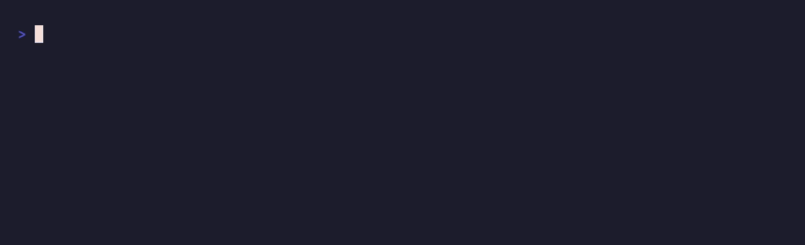
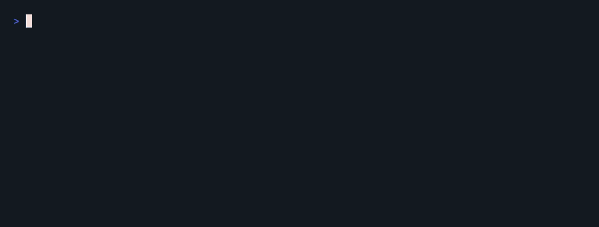
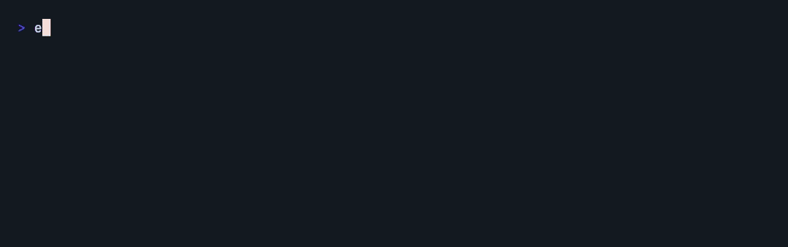
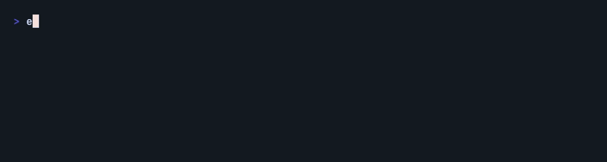
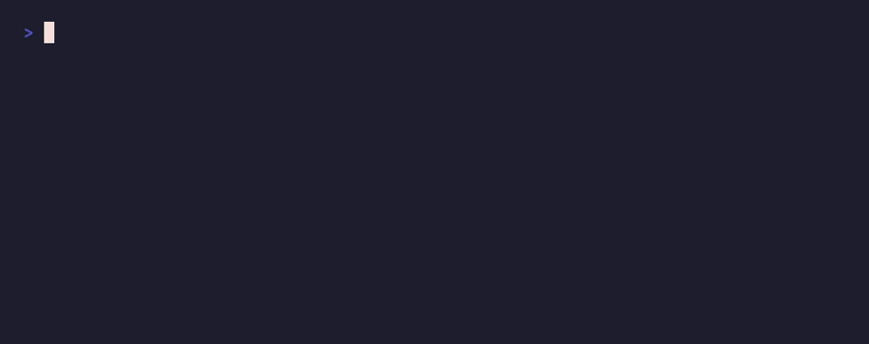

<h3 align="center">Turn any text into big ASCII art banners in your terminal 😱</h3>

<p align="center">
  330+ FIGlet fonts&ensp;·&ensp;colors and gradients&ensp;·&ensp;typewriter, clock and countdown animations&ensp;·&ensp;works offline
</p>

<br>














## Install

```
npm i -g echoascii
```

Or try it without installing:

```
npx echoascii hello
```

You can also add it to a project with `npm i echoascii`. Requires Node.js 18.3 or newer.

## Usage

```
echoascii hello                              # big text in the default font
echoascii --font 'ANSI Shadow' hi there      # pick from 330+ fonts
echoascii --pick hello                       # browse fonts with a live preview
echoascii --fit hello                        # the biggest font that fits the terminal
echoascii --font ./my-font.flf hello         # any FIGlet font file
echoascii --rows 'first row' 'second row'    # one row per argument
echoascii --center --border hello            # center it and draw a box around it
echoascii --shadow --font 'ANSI Regular' hi  # drop shadow, best with block fonts
echoascii --fill '#' hello                   # draw the letters with any characters
echoascii --gradient red,blue hello          # smooth color gradient
echoascii --rainbow hello                    # rainbow colors
echoascii --type --flow hello                # type it out, then make the colors flow
echoascii --decode --rainbow hello           # random characters settle into the text
echoascii --fall --wave hello                # letters drop in, then bob in a wave
echoascii --marquee 'long news ticker text'  # scroll it sideways across the terminal
echoascii --snow --center 'Happy holidays'   # or --rain
echoascii --clock                            # big live clock, ctrl+c to stop
echoascii --countdown 5m "Time's up!"        # countdown, then a message
echoascii --markdown hello                   # a code block to paste into a README
echoascii --comment js 'Section'             # code comments for a file header
echoascii --random hello                     # surprise font
echoascii --list-fonts hello | less          # your text in every font
git branch --show-current | echoascii        # pipe text in
```

## Options

| Option | Description |
| --- | --- |
| `-f, --font <name\|file>` | Font to use. Defaults to `Larry 3D`. Case, spaces and dashes don't matter, and typos get suggestions. Can also be a path to a `.flf` font file. |
| `--fit` | Use the biggest font that fits the width, from Larry 3D down to Mini. Starts with `--font` if you give one. |
| `--rows` | Put each argument on its own row |
| `-w, --width <cols>` | Wrap at this many columns. Defaults to the terminal width. |
| `--center` | Center in the terminal |
| `--border` | Draw a box around the banner |
| `--shadow` | Add a drop shadow one cell down and to the right. Looks best with block fonts like `ANSI Regular`, `Banner3` or with `--fill █`. |
| `--fill <chars>` | Draw the letters with these characters, taking turns, like `#`, `█` or your own text |
| `--trim` | Remove the blank space around the banner, handy for commit messages |
| `--markdown` | Wrap in a markdown code block, for READMEs. Implies `--trim` and skips colors. |
| `--comment <lang>` | Wrap in code comments, for file headers and dividers. Takes a language like `js`, `py`, `sh`, `sql`, `css` or `html`, or a marker like `//` or `#`. Implies `--trim` and skips colors. |
| `-c, --color <color>` | `red`, `green`, `yellow`, `blue`, `magenta`, `cyan`, `white`, `gray`, or a hex color like `ff8800` |
| `-g, --gradient <colors>` | Two or more colors, like `red,blue` or `ff8800,8800ff` |
| `--rainbow` | Rainbow colors |
| `--type` | Type the text out like a typewriter |
| `--decode` | Start as random characters that settle into the text |
| `--fall` | Letters drop in from the top and bounce as they land |
| `--flow` | Make the rainbow or gradient flow, until ctrl+c. Uses the rainbow unless there's a gradient. |
| `--wave` | Letters bob up and down in a wave, until ctrl+c |
| `--marquee` | Scroll the text sideways across the terminal, until ctrl+c |
| `--rain`, `--snow` | Weather falling around the banner, until ctrl+c |
| `--clock` | Show a live clock |
| `--countdown <time>` | Count down from `90`, `90s`, `5m`, `1h30m` or `10:00`, then show the text |
| `-p, --pick` | Pick a font with a live preview: arrows browse, typing searches, enter prints the banner and the command for it |
| `--random` | Use a random font. Its name is printed to stderr. |
| `-l, --list-fonts` | List all fonts, or preview your text in every font |
| `-h, --help` | Show help |
| `-v, --version` | Show the version |

Gradients and hex colors use 24-bit color when `$COLORTERM` says the terminal supports it, and the closest of 256 colors otherwise. One of `--type`, `--decode` or `--fall` can start an animation, and any of `--flow`, `--wave`, `--marquee`, `--rain` or `--snow` can keep it going, like `--decode --wave --flow`. The animations only play in a terminal: piped elsewhere, they print the banner, `--clock` prints the time once and `--countdown` prints each second.

## Use it from JavaScript or TypeScript

```ts
import echoascii from 'echoascii'

console.log(echoascii('hello'))
console.log(echoascii('hello', { font: 'ANSI Shadow', border: true, gradient: 'red,blue' }))
```

It works with `require` too:

```js
const echoascii = require('echoascii')

console.log(echoascii('hello', { font: 'Small', trim: true }))
```

The options are the same as the command line ones: `font`, `fit`, `width`, `center`, `border`, `shadow`, `fill`, `trim`, `markdown`, `comment`, `color`, `gradient` and `rainbow`, plus `truecolor` to force 24-bit colors on or off. Rows are split on newlines.

Types are included:

```ts
import echoascii, { fonts, type Options } from 'echoascii'

const options: Options = { font: 'Doom', center: true, width: 60 }
const banner: string = echoascii('hi', options)

fonts() // every font name
```

Bad input, like an unknown font or color, throws an `EchoasciiError` with a message that's safe to show to users and a `code` (`UNKNOWN_FONT` or `INVALID_OPTION`).

## Config

Set defaults in a `.echoasciirc` JSON file, using the same names as the long options:

```json
{
  "font": "Small",
  "gradient": "cyan,magenta",
  "border": true
}
```

echoascii reads `~/.echoasciirc`, then an `"echoascii"` key in `package.json`, then `.echoasciirc` in the current directory. Later ones win, and options on the command line beat them all. `.echoasciirc.json` works too.

## Fonts

All fonts ship with the package and are read from disk. echoascii never downloads anything. Browse and preview them at [patorjk.com/software/taag](https://patorjk.com/software/taag).

## Upgrading from 1.x

- Node.js 18.3 or newer is required.
- Config files must be JSON. YAML and `.echoasciirc.js` files are no longer read.
- Unknown options like `--foo` are now an error instead of being printed. To print text that starts with a dash, put it after `--`: `echoascii -- --foo`.
